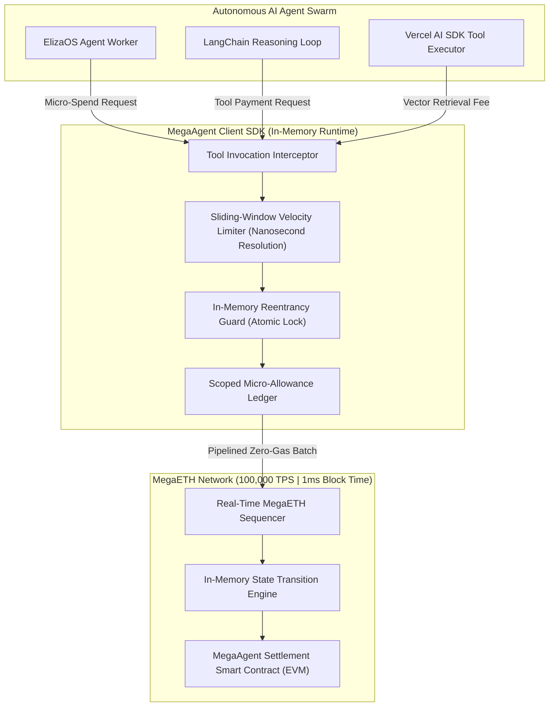
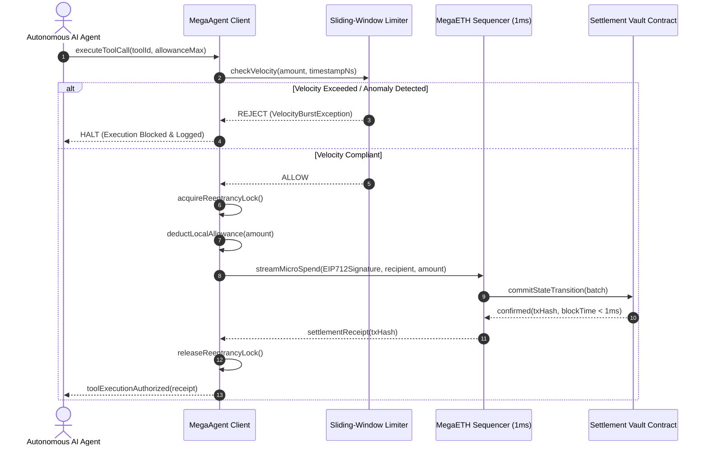

# 🏗️ MegaAgent Protocol: System Architecture & Technical Specification

---

## 🏛️ High-Level System Architecture

MegaAgent coordinates real-time streaming settlements and micro-allowance enforcement between autonomous AI agent swarms and the high-throughput MegaETH sequencer.



---

## ⚙️ Core Architectural Components

### 1. `MegaAgentClient` (In-Memory Execution Engine)
The primary entrypoint for autonomous agents. Manages private key signers, off-chain EIP-712 typed authorizations, and dispatches sub-10ms micro-payments.
* **Location:** [`src/MegaAgentClient.ts`](https://github.com/MegaAgents/mega-agent/blob/main/src/MegaAgentClient.ts)
* **Zero Overhead:** Employs zero asynchronous network lookups during internal allowance balance verification.

### 2. Nanosecond Sliding-Window Velocity Limiter (`SlidingWindowLimiter`)
Enforces mathematical bounds on micro-spend transaction frequencies:
$$\text{WindowRate} = \sum_{i=1}^{N} \text{SpendAmount}_i \quad \text{for } t_i \in [T_{\text{now}} - \Delta t_{\text{window}}, T_{\text{now}}]$$
* **Resolution:** 64-bit nanosecond timestamps (`hrtime.bigint()`).
* **Protection:** Halts runaway execution loops before transactions are broadcasted to the RPC node.

### 3. Reentrancy Immunity Guard
Ensures that recursive or nested agent callbacks cannot drain funds before the previous state balance has been decremented.
* **Mechanism:** Thread-safe in-memory boolean flag locking the active session context.
* **Rejection Latency:** Deterministic sub-10 microsecond exception throw.

---

## 🔄 Interaction Sequence: Autonomous Micro-Payment Settlement



---

## 💾 Memory Layout & Cryptographic Invariants

```
MegaAgent Session Memory Layout:
┌────────────────────────────────┬──────────┬─────────────────────────────┐
│ Field                          │ Type     │ Purpose                     │
├────────────────────────────────┼──────────┼─────────────────────────────┤
│ agentAddress                   │ Address  │ 20-byte EVM Signer          │
│ totalBudgetAllocated           │ uint128  │ Maximum total budget wei    │
│ totalSpentWei                  │ uint128  │ Cumulative spend accounting │
│ maxSpendPerCallWei             │ uint128  │ Single-call spend limit     │
│ lastSpendTimestampNs           │ uint64   │ Monotonic nanosecond timer  │
│ reentrancyActiveFlag           │ bool     │ 1-byte reentrancy lock      │
│ allowedEndpointsBitmask        │ bytes32  │ Whitelisted tool receptors  │
└────────────────────────────────┴──────────┴─────────────────────────────┘
```

---

## 🔒 Security Invariant Verification

1. **Total Spend Invariant:**
   $$\text{totalSpentWei} \le \text{totalBudgetAllocated} \quad (\forall t)$$
2. **Reentrancy Invariant:**
   $$\text{reentrancyActiveFlag} = \text{true} \implies \text{concurrectSpendCalls} = 0$$
3. **Monotonicity Invariant:**
   $$t_{i+1} \ge t_i \quad (\text{Strict Monotonic Nanosecond Clocks})$$
